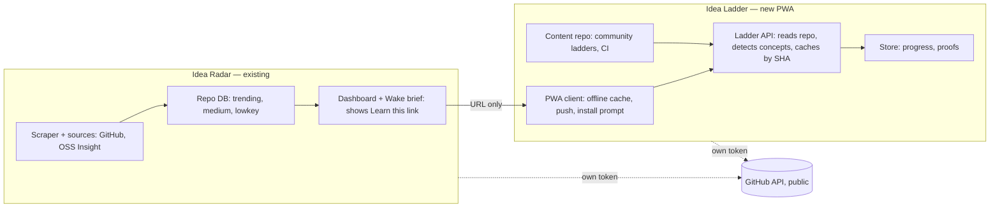
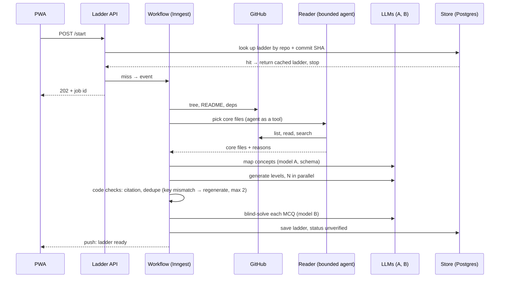
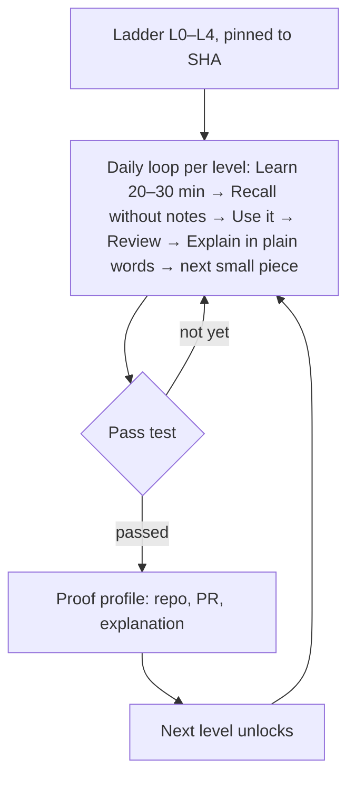
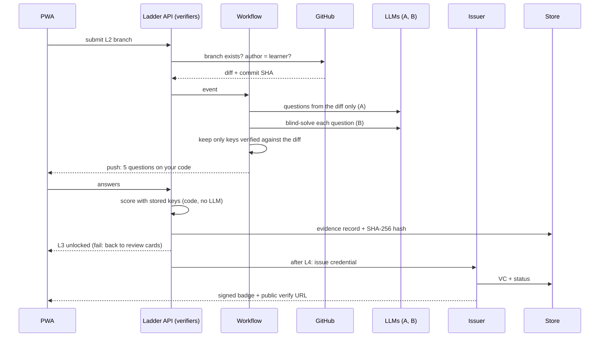

# Main flow — Idea Ladder

Source: all 7 diagrams of the requirement doc (read 2026-11-01), as text in `docs/REQUIREMENT_SOURCE.md` § Diagram text.

## 1. Components — "Two apps, one URL between them, nothing shared"

## 2. Ladder generation — "generated once per repo commit, then cached"

## 3. Learner loop — vision flow + daily loop

## 4. Pass test and proof — "The LLM writes questions; only code decides the pass"

## 5. Conflicts inside the source (to settle before v1)

| # | Conflict | Where | Suggested reading |
|---|---|---|---|
| C1 | Daily loop says "Review 1, 3, 7, 21 days" (fixed intervals); the stack says FSRS (adaptive intervals, "Deterministic review intervals") | daily-loop diagram vs § Framework stack | FSRS wins; the fixed days are an illustration |
| C2 | Pass-test diagram names the Issuer an "OB 3.0 signer" issuing a VC; the stack says "Plain signed JSON for v1, upgrade at v2" | pass-test diagram vs § Framework stack | v1 = plain signed JSON (T001 tested this); OB 3.0 at v2 |
| C4 | Gate 3 (before v3) needs a "first outside ladder PR", but the community ladders repo that receives such a PR is built in v3 (T025) | roadmap diagram | T025 may start once Gate 3's "proof links get shared" part passes; the outside-PR part is then checked after T025 |
| C3 | Vision says "review daily in 5 minutes"; the daily loop starts with "Learn 20 to 30 min" | § Vision vs daily-loop diagram | 5 min = review only; a level's learn step is longer |

## 6. Facts from the diagrams that change earlier assumptions

- **Idea Radar exists** ("Idea Radar (existing)") and its Repo DB already sorts repos into trending, medium, lowkey. The v0 repos were picked by the Supervisor because Radar is not in this repo; picking them from Radar's DB is closer to the requirement.
- The **diff questions are blind-solved by model B too**. T001's result (code check alone false-rejects 11.3%) applies to both MCQs and diff questions.
- Each app calls the GitHub API **with its own token** — v1 needs a token (T001 used the unauthenticated limit of 60/h).
