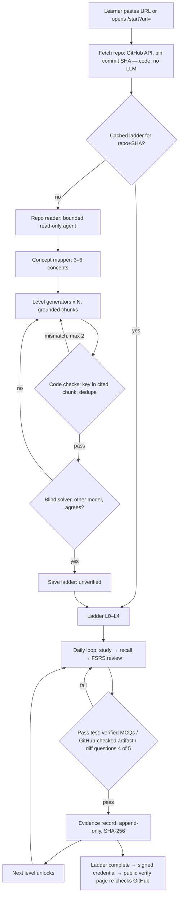

# Main flow — Idea Ladder

Source: `docs/REQUIREMENT_SOURCE.md` § Vision flow, § Diagram text (generation pipeline), § Sequence: pass test and proof.

v0 replaces everything above the "Ladder" node with hand-made ladders (`claude` CLI) and replaces the
daily loop with Anki (FSRS on). T001 measures the nodes "Code checks" and "Evidence record".
